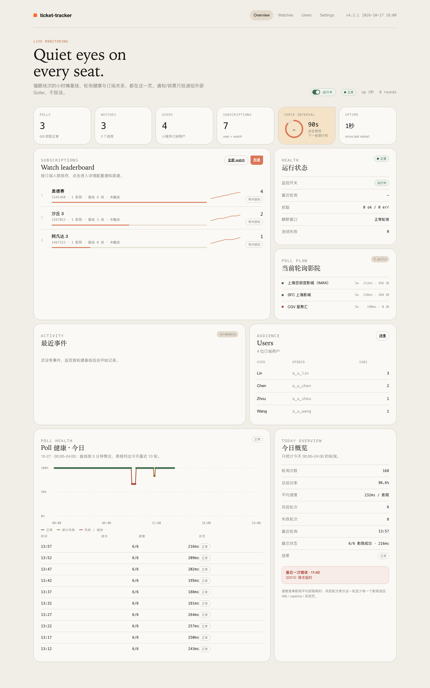
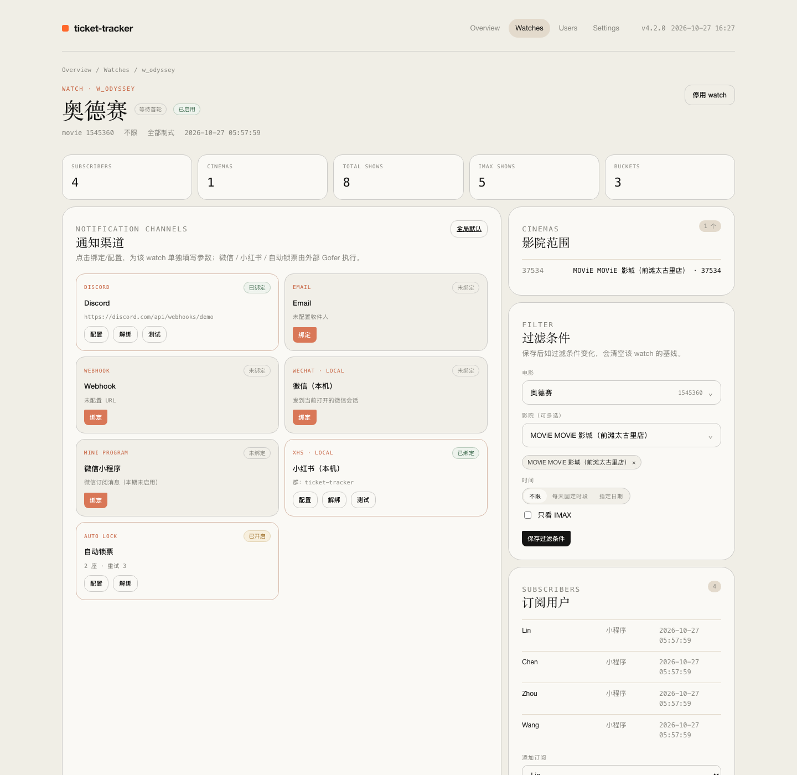
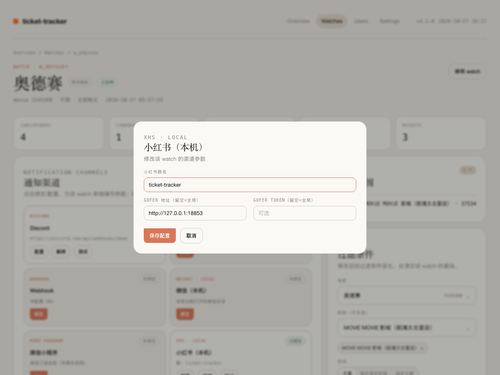
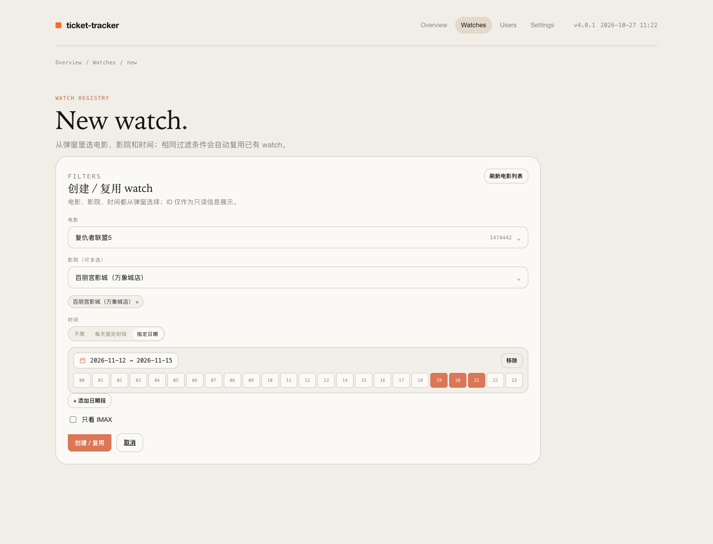
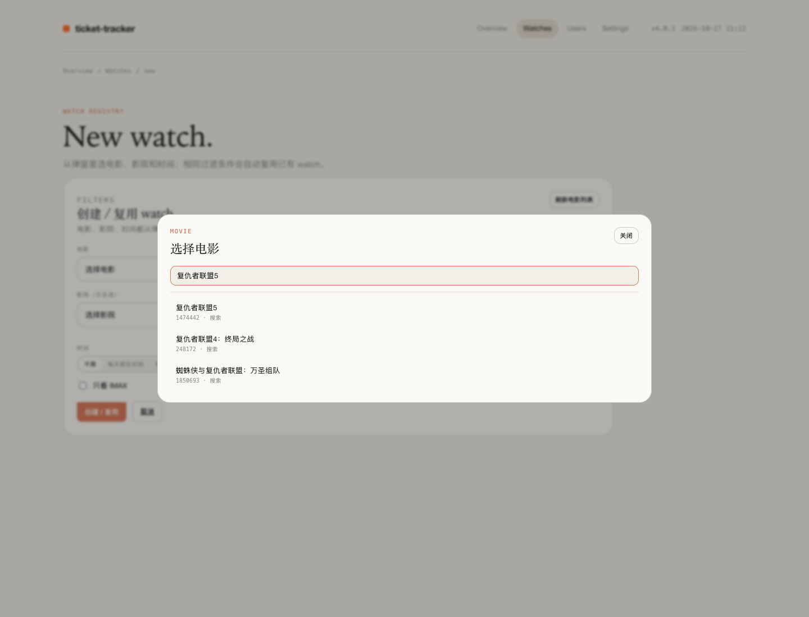
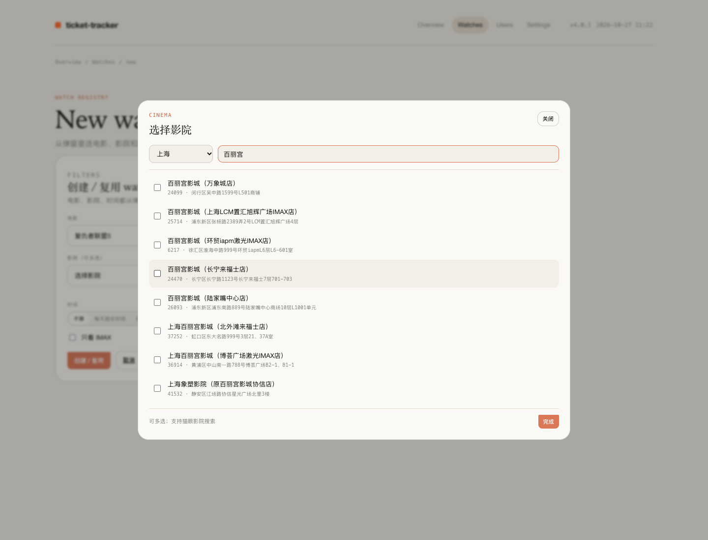
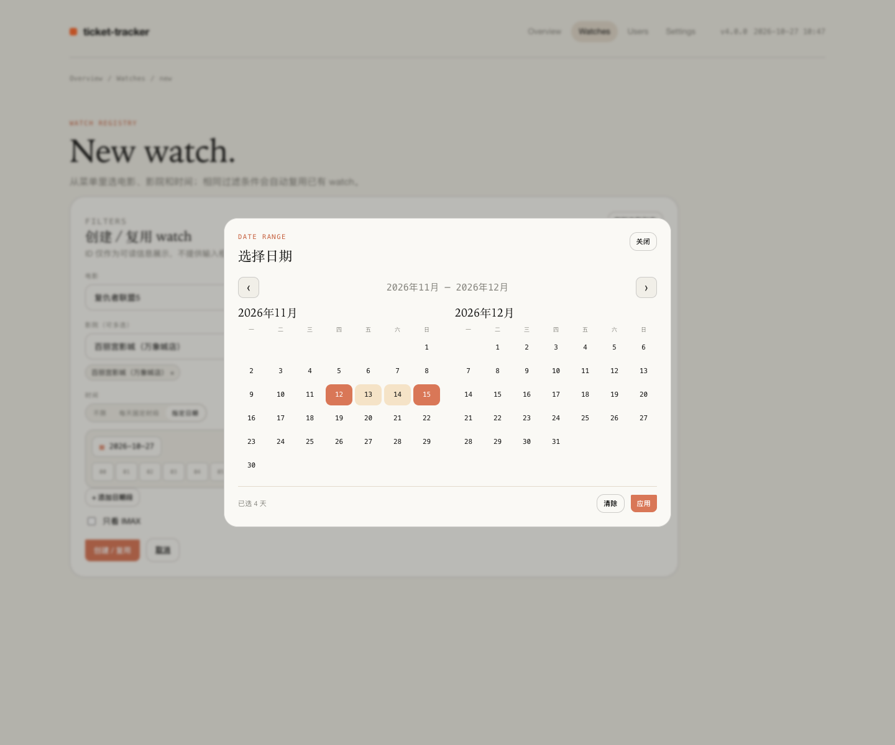

# v4 无头主服务 + 外部 Gofer + Web 面板

> 本文档描述 v4 架构：`tt-server` + 外部 Gofer + SQLite + Web 面板。
> 项目只保留 v4 服务端；本机通知/锁票由独立 Gofer 服务执行。









 ·  · 

## 1. 架构

```text
                       ┌──────────────────────────────────────────┐
  浏览器 ──SSH 隧道──>  │ tt-server（无头）                         │
                       │  ├─ axum: /api/v1 + Web 面板 + 静态资源     │
                       │  ├─ DB-backed monitor loop                 │
                       │  ├─ thin dispatcher                        │
                       │  └─ SQLite（settings/watches/polls/users） │
                       └───────┬──────────────────┬─────────────────┘
                               │ 直连              │ POST /notify
                               │                   │ POST /lock
                               ▼                   ▼
                    Discord / 邮件 / webhook    Gofer（独立服务）
                    / 小程序 push（stub）         ├─ 通知串行队列
                                                  ├─ 锁票串行队列 → maoyan-booker
                                                  ├─ 微信 GUI 脚本
                                                  └─ 小红书 GUI 脚本
```

设计取舍：

- **通知投递不持久化**：monitor 触发后 push 给 dispatcher；Gofer 不在线就记录失败/丢弃，可接受。
- **不探活**：监控不检查 Gofer / 微信 / 小红书状态；Gofer 离线不是监控健康异常。
- **Gofer 不轮询**：暴露 `POST /notify` / `POST /lock`，收到即 202，通知与锁票各自串行执行。
- **poll 快照不落盘**：每轮抓取的影院快照只在内存；落盘的是 watch 基线、图表采样与每轮健康采样。
- **watch 去重**：`movie_id + sorted(cinemas) + time_spec + imax_only` 相同的 watch 复用。
- **用户层在业务侧**：users/subscriptions 表与 API 已就绪；真实微信登录/订阅消息适配器留接口。
- **自动锁票在 Gofer**：主服务只把 lock 任务 push 给 Gofer；booker 在 Mac 上执行，
  结果记录在 Gofer 面板。自动锁票在监控面板里是一个 `AUTO LOCK`
  渠道卡片，绑定=开启，配置里保存票数/重试/座位，并可为该 watch 指定独立 Gofer 地址。

## 2. 快速启动（原生）

```bash
cd rs
cargo build --release --bin tt-server

# 主服务（默认只绑 localhost）
./target/release/tt-server \
    --db ~/.local/state/ticket-tracker/ticket-tracker.db \
    --bind 127.0.0.1:8787

# 外部 Gofer 在独立项目运行（../Gofer）
# gofer serve --bind 127.0.0.1:8790
```

打开 `http://127.0.0.1:8787`。

首次启动会自动创建 SQLite、执行 migrations，并写入默认设置和内置影院预设。

## 3. Docker（只用于主服务）

```bash
cd rs
docker compose up -d --build
# 或
docker build -t ticket-tracker .
docker run -d --name ticket-tracker \
  -p 127.0.0.1:8787:8787 \
  -v ticket-data:/data \
  ticket-tracker
```

- 端口只发布到宿主机 `127.0.0.1`，远程用 SSH 隧道：

```sshconfig
Host ticket
    HostName your-server
    User your-user
    LocalForward 8787 127.0.0.1:8787
```

- 容器内 `TT_DB=/data/ticket-tracker.db`，必须挂 volume。
- **Gofer 不能放 Docker**：它需要 macOS 的微信/小红书 GUI。
- Docker 内首次启动 DB 为空；通过 API 或挂载已有 SQLite 文件导入数据。

## 4. 外部 Gofer

Gofer 是独立项目：[`Gofer`](https://github.com/kuicao55/Gofer)。它负责三项能力：

- 微信（本机）通知
- 小红书群聊通知
- maoyan-booker 锁票

启动：

```bash
cd ../Gofer
cargo build --release
./target/release/gofer serve --bind 127.0.0.1:8790
# 面板：http://127.0.0.1:8790
```

CLI：

```bash
gofer notify --channel wechat -m "放票了"
gofer notify --channel xhs --group "群名" -m "放票了"
gofer lock --cinema-id 37534 --movie-id 1545360 \
  --show-date 2026-11-12 --num-seats 2
gofer requests --limit 20
```

HTTP：

- `POST /v1/notify`（也兼容 `/notify`）
- `POST /v1/lock`（也兼容 `/lock`）
- `GET /v1/requests/:id`
- `GET /health`

监控主服务只在 settings 里保存 `agent_url` / `agent_token`，向 Gofer 投递，不读取
Gofer `/health`，也不因为 Gofer 不在线产生健康告警。Gofer 的 `--dry-run` 只影响
微信/小红书通知；锁票始终真锁。

## 5. 数据库

SQLite + WAL，迁移文件：`rs/migrations/0001_init.sql`、`0002_autolock.sql`、`0003_movies.sql`、`0004_poll_health.sql`、`0005_watch_channel_config.sql`。

| 表 | 作用 |
|---|---|
| `settings` | check_interval / silent_window / agent_url / agent_token / discord_webhook / wx_* |
| `cinemas` | 影院注册表（收藏夹/名称缓存）；Web 影院选择器的数据源 |
| `movies` | 电影列表缓存；从猫眼热映/即将/经典拉取，或从已有 watch 导入 |
| `polls` | 当前被 enabled watch 使用的唯一影院 + 最近抓取状态/耗时/场次数 |
| `watches` | watch 过滤条件 + `auto_lock` / 锁票参数；`filter_key` UNIQUE 去重 |
| `lock_state` | 每 watch × 影院的锁票状态（ok/failed/exhausted/tries/last_event_id） |
| `watch_cinemas` | watch × cinema |
| `watch_state` | 每个 watch × 影院的上次小时桶基线（engine JSON） |
| `watch_metrics` | 图表采样：total / IMAX / buckets / added，保留 7 天 |
| `poll_health` | 每轮 poll 健康采样：影院成功/失败、疑似风控数、单影院平均耗时，保留 7 天 |
| `users` | 小程序用户（openid/unionid/nickname） |
| `channels` | 通知渠道（discord/webhook/email/wechat_local/xhs_local/autolock/wechat_miniprogram） |
| `watch_channels` | watch × channel 绑定 + `config_json`（该 watch 的群名/URL/agent 地址/锁票参数） |
| `subscriptions` | user × watch（可选 channel） |
| `push_consents` | 微信订阅消息授权/配额（预留） |

### poll 与 watch 的关系

```text
每轮：
  1. 读 enabled watches + watch_state
  2. build_poll_plan → 唯一影院集合
  3. sync_polls（watch_count/last status）
  4. fetch_plan_live（并发 + gzip）
  5. 记录 poll_health（成功率 / 风控 / 速度）
  6. evaluate_cinema（engine 纯逻辑）
  7. 事务写回 watch_state + watch_metrics
  8. 有增量 → 内存事件 + dispatcher push
```

影院快照本身不落盘；落盘的是**基线**、**图表采样**和**每轮健康采样**。

## 6. API v1

默认 `127.0.0.1:8787`，全部 JSON。

| 方法 | 路径 | 说明 |
|---|---|---|
| GET | `/health` | 公开健康检查（iGlance 使用） |
| GET | `/` | Web 面板（需要登录；iGlance 通过 `endpoints.panel` / `urls.panel` 打开） |
| GET/POST | `/setup` | 首次升级创建面板密码 |
| GET/POST | `/login` | 面板登录 |
| POST | `/logout` | 退出面板会话 |
| GET | `/api/v1/health` | uptime、last/next poll、paused、fetch ok/err、DB、delivery |
| GET | `/api/v1/service` | iGlance `iglance.service.v1` 状态 + 内存 + controls（`/v1/service` 同义） |
| GET | `/api/v1/service/memory` | 仅内存快照 |
| POST | `/api/v1/service/pause` / `resume` / `toggle` | 暂停 / 恢复监控 |
| POST | `/api/v1/service/stop` | `202` 后退出，清理 PID / launchd job |
| GET | `/api/v1/dashboard` | KPI + top watches/polls + events + health |
| GET | `/api/v1/polls` | poll 列表 |
| GET/POST | `/api/v1/watches` | 列表（`sort=subscribers`）/ 创建或复用 |
| GET/PATCH/DELETE | `/api/v1/watches/:id` | 详情 / 编辑 / 删除 |
| GET/PUT | `/api/v1/watches/:id/channels` | 绑定渠道 |
| GET | `/api/v1/watches/:id/metrics?range=24h\|7d\|30d` | 图表数据 |
| GET/POST | `/api/v1/channels` | 渠道列表 / 新建 |
| PATCH/DELETE | `/api/v1/channels/:id` | 修改 / 删除 |
| GET/POST | `/api/v1/users` | 用户列表 / 新建 |
| DELETE | `/api/v1/users/:id` | 删除用户 |
| GET | `/api/v1/users/:id/subscriptions` | 用户订阅 |
| GET/POST | `/api/v1/subscriptions` | 订阅列表 / 新建 |
| DELETE | `/api/v1/subscriptions/:id` | 取消订阅 |
| GET/PATCH | `/api/v1/settings` | 全局设置（含 `lock_headless`） |
| GET | `/api/v1/movies?q=&limit=` | 本地电影缓存 / 搜索 |
| GET | `/api/v1/movies/search?q=` | 搜索任意电影（猫眼全量；纯数字按 movieId 查详情） |
| POST | `/api/v1/movies/refresh` | 从猫眼刷新热映/即将/经典列表 |
| GET | `/api/v1/cinemas/search?q=` | 搜索任意影院（按 `maoyan_city_id` 城市） |
| GET | `/api/v1/events` | 内存最近事件 |
| POST | `/api/v1/agent/lock-result` | **Gofer 回调锁票结果**（best-effort 内部接口） |
| POST | `/api/v1/auth/wx/login` | 预留（当前 501） |

示例：

```bash
curl -X POST http://127.0.0.1:8787/api/v1/watches \
  -H 'Content-Type: application/json' \
  -d '{"movie_id":1545360,"movie_name":"奥德赛",
       "cinemas":["37534"],"time":"2026-11-12 19:00-22:00",
       "imax_only":true}'

curl -X POST http://127.0.0.1:8787/api/v1/users \
  -H 'Content-Type: application/json' \
  -d '{"openid":"o_xxx","nickname":"用户"}'

curl -X POST http://127.0.0.1:8787/api/v1/subscriptions \
  -H 'Content-Type: application/json' \
  -d '{"user_id":"u_xxx","watch_id":"w_xxx"}'
```

## 7. Web 面板

- `/`：KPI（polls / watches / users / subscriptions / 检查间隔圆环 / uptime）、
  watch leaderboard（按订阅数降序，显示当前基线场次数 + 24h 迷你折线）、顶部监控开关、健康、
  poll 列表、最近事件、users、**Poll 健康今日图（00:00–24:00）**（成功率曲线按 5 分钟聚合，
  正常绿 / 部分失败黄 / 风控红，附最近 10 轮状态与速度）。
- `/watches`：全部 watch。
- `/watches/new`：电影/影院使用**可搜索下拉菜单**（电影支持任意片名/ID，
  影院支持名称/ID/地址），时间用「不限 / 每天固定时段 / 指定日期」；
  日期是**酒店式范围弹层**，小时是 **GitHub 贡献图风格方块**；**不需要输入任何 ID**。
- `movies` 缓存在 SQLite；右上角「刷新电影列表」可更新热映/即将/经典。
- `/watches/:id`：过滤条件（电影/影院弹窗 + 时间选择器）、订阅用户、**通知渠道卡片**
  （点「绑定/配置」弹窗填写该 watch 独立参数：Discord URL、邮箱、小红书群名、
  Agent 地址/token；`AUTO LOCK` 卡片含票数/重试/座位 + 每影院锁票状态）、
  固定坐标轴基线图、按日期分段标签筛选的**基线场次表**（只列基线里存在的日期/场次）。
- `/users`：用户列表 + 测试用户创建。
- `/settings`：检查间隔、静默窗口、Discord 健康告警、Gofer 投递地址、渠道默认值、
  小程序配置、影院搜索城市（`maoyan_city_id`，默认 10=上海）。
- `/update`：检查 GitHub Release、显示 release notes、SHA256 校验后替换二进制并重启。
  launchd 部署用 `TT_SUPERVISED=launchd`；start-server.sh 部署由重启助手接管 PID/日志。

视觉：warm parchment + editorial serif + monospace 数据 + clay/ember 强调。
HTMX 每 5 秒刷新片段；倒计时和 uPlot 图表由本地 JS 驱动。

## 8. 通知语义

```text
watch 触发
  → 内存事件（面板）
  → dispatcher
       ├─ Discord / webhook / email：直接发送
       ├─ wechat_local / xhs_local：POST Gofer（3s 超时，202 即完成）
       └─ wechat_miniprogram：统计订阅目标，当前不真实发送
```

- 每个 watch × channel 的 `config_json` 覆盖全局渠道默认值；微信/小红书/自动锁票
  还可以在绑定里覆盖 Gofer URL / token（存储字段仍为 `agent_url` / `agent_token`，留空回退全局）。
- 每个渠道独立失败，不互相阻塞。
- 不持久化、不重试队列；Gofer/通知服务挂掉 = 丢事件（已接受）。
- 静默窗口内不抓取、不发送。
- 健康异常只在「正常 → 异常」时发一次 Discord；不发启动/停止/心跳。

### 自动锁票

```text
watch 触发
  → lock_state 未 ok / 未 exhausted
  → 用该绑定的 agent_url/token（留空回退全局）POST Gofer /lock (confirm=true)
  → Gofer 串行执行 booker
  → Gofer 记录结果（监控不依赖回调）

```

约束：

- 只有 watch 级 `auto_lock=true`（即 `AUTO LOCK` 渠道已绑定）才锁；没有全局总闸。
- 同一 watch × 影院成功后不再重复锁；失败按 `lock_max_retries` 消耗重试。
- 过滤条件变化会清空该 watch 的 `lock_state`。
- 只运行一个 `tt-server` 实例（`server.lock` 单实例锁）；锁票由 Gofer 串行执行。

## 9. 小程序

本期已完成：

- `users` / `subscriptions` 表
- 用户/订阅管理 API
- 面板用户数与订阅列表
- `subscriptions` 按 watch 查询，dispatcher 已能统计小程序推送目标

未完成（需要你的小程序信息）：

- `wx.login` → `jscode2session` 换 openid
- `wx.requestSubscribeMessage` 授权与 `push_consents` 配额
- `subscribeMessage.send` 真实发送
- 每个用户的个性化消息模板

在真实接入前，请不要把 `/api/v1/*` 暴露到公网。

## 10. 安全与部署

- 默认只绑定 `127.0.0.1`；远程请用 SSH 隧道或 Tailscale。
- Web 面板需要密码登录（Argon2 哈希 + HMAC 会话 Cookie）。首次升级后访问 `/setup` 创建密码；
  密码哈希和 session secret 只写入现有 `settings` 表的新 key，不改旧数据。
- 业务 API 尚未内置鉴权；`/api/v1/service*` 在设置 `panel_token`（或 `TT_SERVICE_TOKEN`）后要求
  `X-Gofer-Token` / `X-Agent-Token` / `Authorization: Bearer`，`/health` 始终公开。
  Gofer callback 可用 `agent_token` 校验（best-effort，不参与健康）。
- 不要把 8787 直接暴露公网；小程序公网 API 需要单独的鉴权/HTTPS/备案域名。
- 可选 `TT_PUBLIC_URL` 指定对外面板地址（Tailscale / 反代）；iGlance 的
  `urls.display` / `urls.panel` 会基于它生成，默认回退到本地监听地址。
- Docker 只发布到宿主机 localhost。
- SQLite 单实例 + WAL；多实例请换 Postgres。
- launchd 模板：`rs/deploy/launchd/com.kuicao.ticket-tracker.plist`。

## 11. 自动更新 / Release

- 面板 `/update` 从 GitHub `releases/latest` 检查更新。
- Release 资产：
  - `tt-server-aarch64-apple-darwin`
  - `tt-server-x86_64-apple-darwin`
  - `start-ticket-tracker.sh`
  - `SHA256SUMS`
- 下载后强制校验 SHA256；校验通过才替换当前二进制，并保留 `.bak`。
- 发版：
  ```bash
  git tag v4.9.0
  git push origin v4.9.0
  ```
  `.github/workflows/release.yml` 会构建 macOS x86_64/aarch64 二进制、生成
  `SHA256SUMS` 并发布 Release。
- 公开仓库通常无需 token；限流时设置 `TT_UPDATE_TOKEN`。
- 旧二进制备份：同目录下的 `tt-server.bak`。
